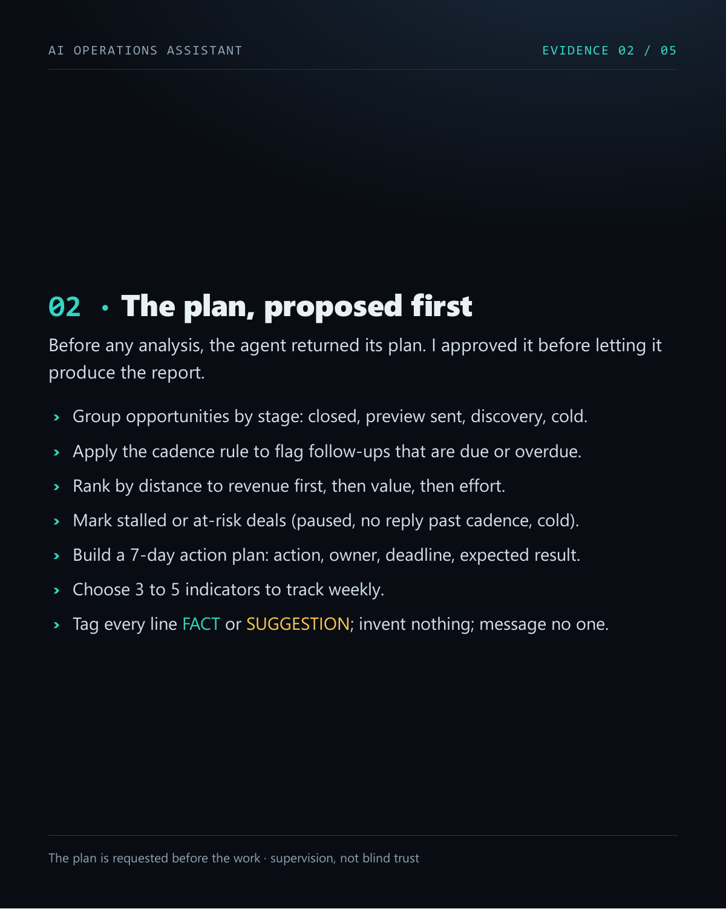
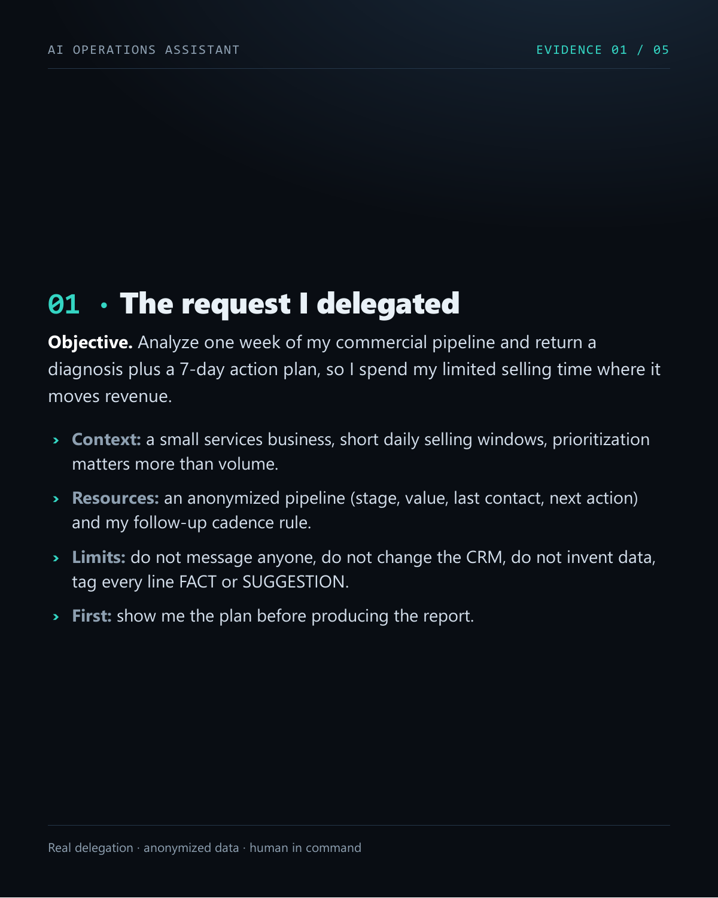
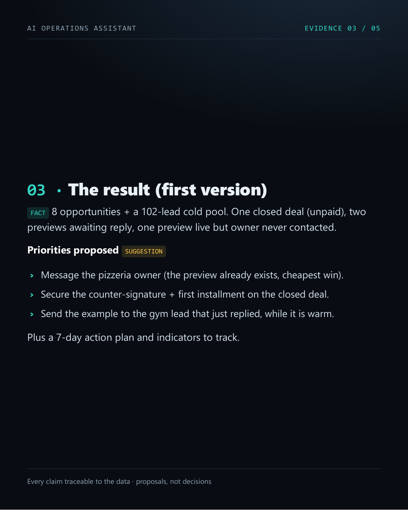
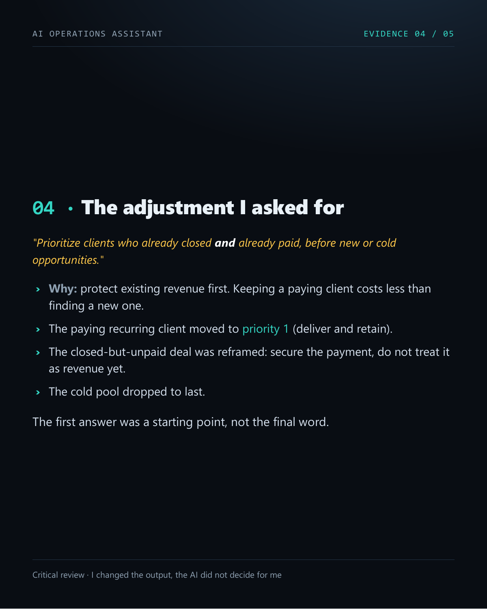
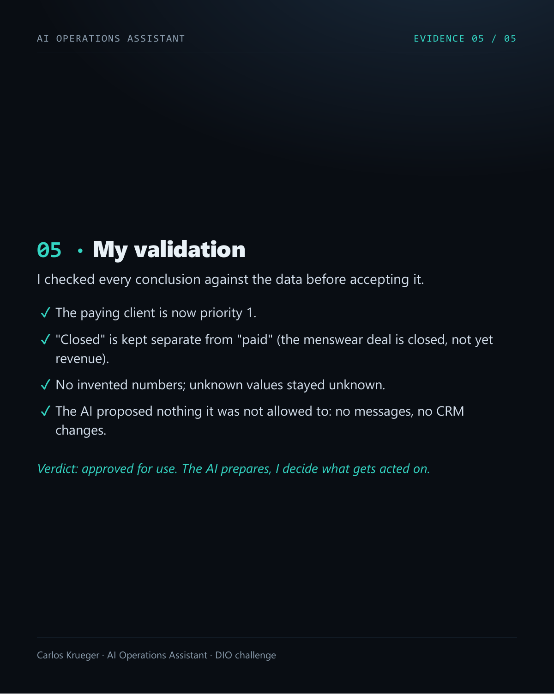

# Meu Kit de IA

Desafio de Projeto da [DIO](https://dio.me): monte o seu kit de IA para o dia a dia e delegue uma tarefa real, com você no comando.

O kit foi criado pelo Expert Bruno Lima com os prompts, templates, checklists e skills usados nas Aulas. Ele não é uma apostila: abra a pasta que resolve o seu problema, copie o modelo, adapte e use.

**Copie → adapte → teste → confira → melhore**

## Como Fazer o Desafio

Você não precisa instalar nada nem saber programar. Tudo acontece no navegador.

1. Clique em **Use this template**, depois em **Create a new repository**. Dê um nome simples, como `meu-kit-de-ia`, deixe **Public** e confirme.
2. Siga os passos abaixo com uma tarefa real da sua semana.
3. Preencha a seção [Minha Entrega](#minha-entrega) da sua cópia e entregue o link dela na DIO.

## Os Passos

1. **Escolha uma tarefa real.** Comece pelo trabalho que se repete na sua semana, como preparar uma reunião ou montar um relatório, e não pela ferramenta.
2. **Pegue um modelo.** Abra a pasta do kit que combina com a sua tarefa. Cada modelo tem um botão de copiar no canto.
3. **Adapte.** Troque o que está entre colchetes pelo seu contexto, objetivo, dados, limites e formato.
4. **Teste.** A primeira resposta é um ponto de partida. Ajuste até funcionar para a sua realidade.
5. **Delegue.** Com o [template de delegação](02-templates/03-delegacao.md), entregue a tarefa à IA. Peça o plano antes de ela começar, acompanhe e valide o resultado.
6. **Confira.** Provável não é o mesmo que verdadeiro. Revise com o [Pare, Confira, Use](03-checklists/01-pare-confira-use.md) antes de usar.

## O Que Tem no Kit

| Pasta | Para que serve |
|---|---|
| [01-prompts](01-prompts) | Pedidos prontos para adaptar: escrita, comunicação, pesquisa, comparação e preparação de reuniões |
| [02-templates](02-templates) | Estruturas para preencher: bom pedido, pesquisa e decisão, e delegação |
| [03-checklists](03-checklists) | Revisão de respostas, de textos e de tarefas delegadas |
| [04-skills](04-skills) | Como criar uma skill, e a Skill Preparador de Reuniões usada nas Aulas |
| [05-delegacao-e-automacao](05-delegacao-e-automacao) | Gatilhos de automação, supervisão e checkpoints |

## Os Frameworks das Aulas

- **Bom pedido:** contexto + instrução + objetivo + formato. Quanto menos a IA precisa adivinhar, melhor você consegue avaliar a resposta.
- **Pesquisa e decisão:** pergunta → pesquisa → critérios → comparação → você. Peça fontes quando precisar de informação externa. A decisão final é sua.
- **Segurança:** pare → confira → use. Valide fatos, números, datas, fontes e contexto.
- **Atalhos reutilizáveis:** criar → testar → ajustar → salvar. Separe as instruções fixas das informações que mudam a cada uso.
- **Delegação:** objetivo + contexto + recursos + limites + sucesso. Autonomia funciona melhor quando o resultado esperado está claro.
- **Supervisão:** definir → delegar → acompanhar → validar. Em tarefas maiores, confira o plano, acompanhe os checkpoints e valide o resultado.

> A IA pode ajudar você a escrever, pesquisar, organizar e executar. A responsabilidade pelo resultado continua sendo sua.

---

## Minha Entrega

> I filled this section with a real task from my own business. All data is anonymized: no names, contacts, companies or links. The AI prepares, I decide what gets acted on.

### Minha Tarefa Real

I chose a task from my own business (Krueger Labs): a **weekly review of my commercial pipeline**. It repeats every week, it decides where I spend my limited selling time, and it is safe to publish because the pipeline is fully anonymized. The point of delegating it is to get a clear diagnosis and a 7-day action plan I can actually run, while the AI never acts on its own.

### Meus Atalhos

I adapted two shortcuts from the kit into reusable skills. In both, the **fixed part** is the role, the rules and the output format; **what changes each use** is the context and the data I paste inside the brackets.

- **Shortcut 1 — Meeting Intelligence** (`01-prompts/meeting-intelligence.md`): turns scattered context into an executive briefing before a meeting.
- **Shortcut 2 — Business Operations Intelligence** (`01-prompts/business-operations-intelligence.md`): turns raw operational data into a report plus an action plan, tagging every line as FACT or SUGGESTION.

```text
Act as a Senior Forward Deployed Engineer and meeting advisor.
Turn the context below into a short executive briefing.

FIXED: identify the main problem; separate facts from assumptions; define the
objectives; build a prioritized agenda with time estimates; list the critical
questions; propose decisions and next steps. Never invent facts. Do not send
messages or schedule anything. I approve every decision.

CHANGES EACH USE: [company] [meeting type] [participant roles] [current situation]
[previous decisions] [open issues].
```

```text
Act as a Senior Business Operations Analyst with FDE experience.
Turn the data below into a report plus a 7-day action plan.

FIXED: tag every line [FACT] or [SUGGESTION]; never fabricate numbers; do not
treat an inactive deal as lost; do not contact anyone or change records; keep
commercial status separate from commercial stage.
OUTPUT: snapshot, data quality, opportunities, risks and bottlenecks,
action plan (priority, action, outcome, KPI, deadline), decisions that need me.

CHANGES EACH USE: [business] [period] [objective] [data source] [KPIs].
```

### Minha Delegação

```text
Objective: analyze one week of my commercial pipeline and return a diagnosis plus
a 7-day action plan, so I spend my limited selling time where it moves revenue.
Context: a small services business; short daily selling windows; prioritization
matters more than volume.
Resources: the anonymized pipeline in 02-templates/commercial-pipeline-input.csv
(stage, value, last contact, next action) and my follow-up cadence rule.
Limits: do not message anyone; do not change the CRM; do not invent data; tag every
line FACT or SUGGESTION; submit decisions for my approval.
Success: a diagnosis consistent with the data and a plan I can actually run.
Before you start: show me the plan. Do not produce the report until I approve it.
```

### O Plano da IA

The agent returned its plan **before** any analysis. I read it, approved it, then let it proceed. Asking for the plan first is what keeps me in control of a bigger task.



### O Resultado

The first result was good, but I did not accept it as is. I asked for one change: **prioritize clients who already closed and already paid, before new or cold opportunities.** The agent reordered the priorities, moved the paying client to first, and reframed the closed-but-unpaid deal as "secure the payment". I then validated every conclusion against the data before using it.






### Como Foi para Você

The biggest change was treating the AI as something I **supervise**, not something I trust blindly. Asking for the plan first, tagging facts versus suggestions, and setting hard limits (no messages, no CRM changes) turned a generic chat into a repeatable part of my weekly routine. The AI prepares; I decide what gets acted on.
